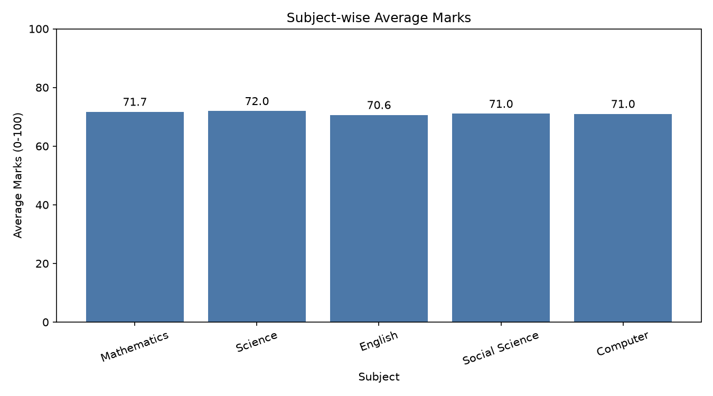
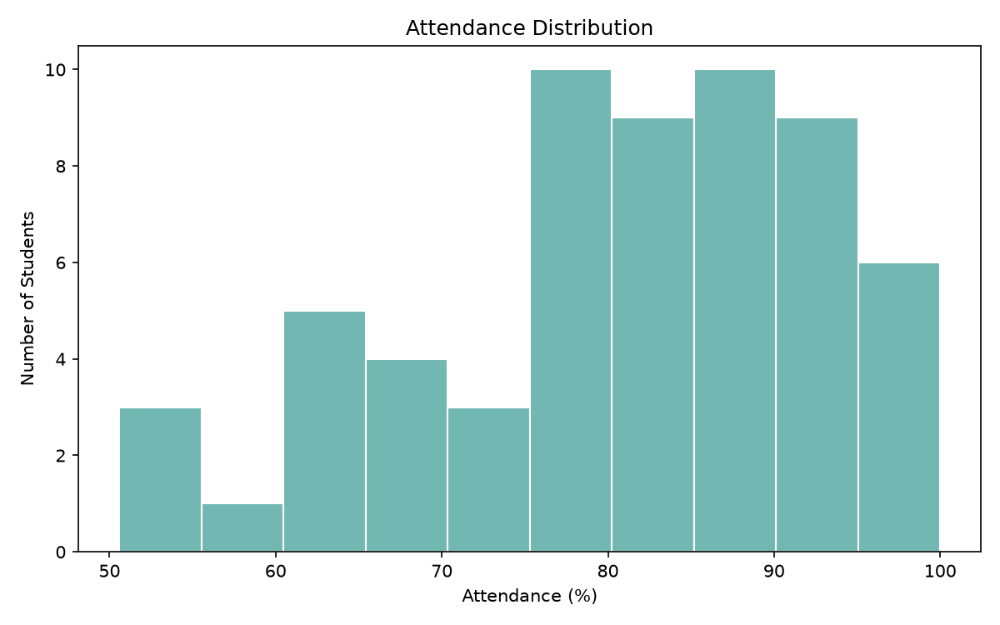
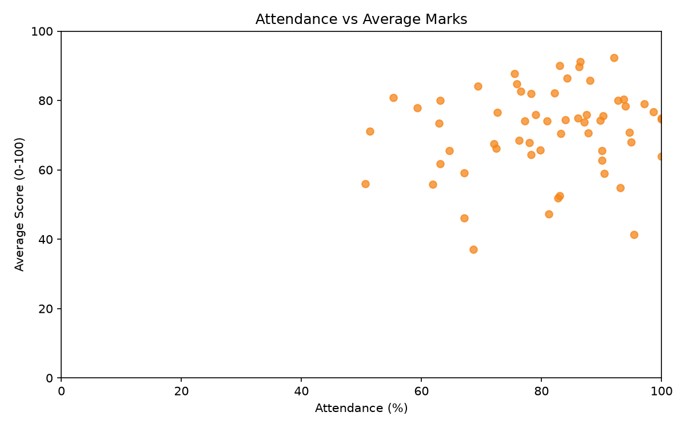
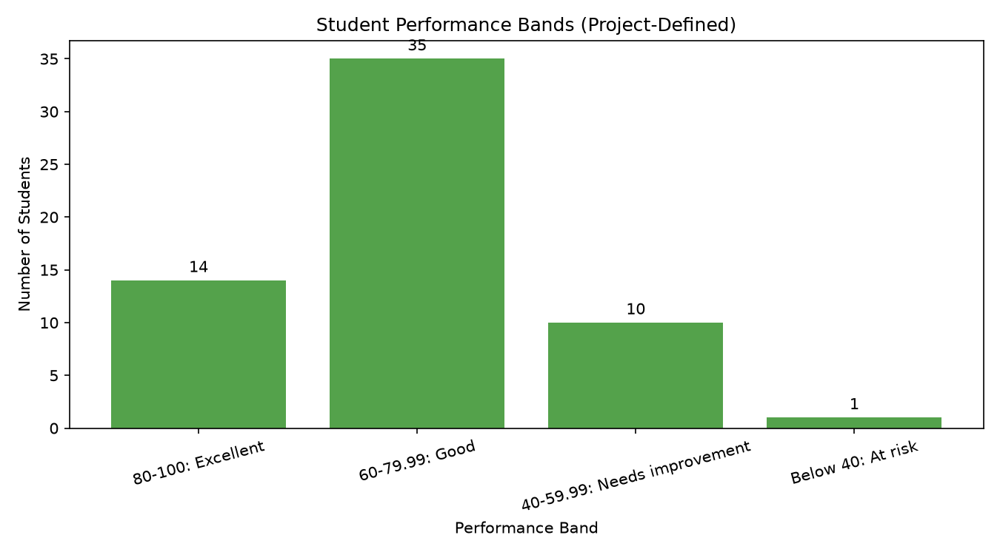
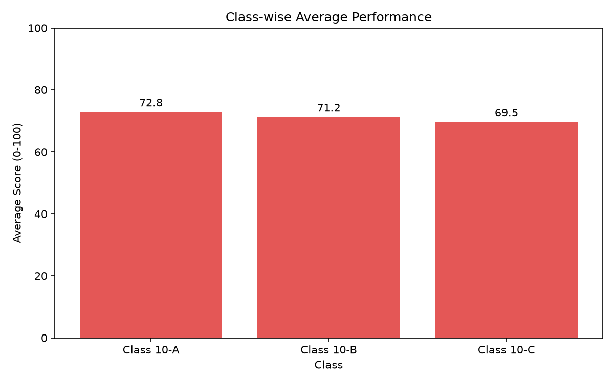

# Student Performance Analysis | SQL & Data Analytics

A beginner-friendly, portfolio-ready data analytics project using **MySQL, Python, Pandas, and Matplotlib** to explore student marks, attendance, subject-wise performance, and academic trends.

> **Data note:** This repository uses a clearly labelled **synthetic dataset** (`data/raw/student_performance.csv`) with fictional student records for demonstration/portfolio purposes. Do not present these findings as real-world facts.

## Live/Portfolio presentation

- **GitHub repo**: push this project and use the README + charts as the main portfolio artifact.
- **Vercel static page**: `index.html` + `styles.css` provide a clean portfolio landing page for interviews.
- **Notebook**: `notebooks/student_performance_analysis.ipynb` for interactive walkthrough.

## Key findings (from executed analysis)

| Metric | Result |
|---|---|
| Records analyzed | 60 synthetic students |
| Highest avg subject | Science (71.96) |
| Lowest avg subject | English (70.62) |
| Attendance < 75% | 16 students (26.67%) |
| Attendance vs avg score | Pearson r = 0.1471 (weak positive; **not causation**) |
| Top class | Class 10-A (72.83 avg) |

### Performance bands (project-defined)
- Excellent (80-100): 14 (23.33%)
- Good (60-79.99): 35 (58.33%)
- Needs improvement (40-59.99): 10 (16.67%)
- At risk (<40): 1 (1.67%)

## Charts

| Subject averages | Attendance distribution |
|---|---|
|  |  |

| Attendance vs marks | Performance bands |
|---|---|
|  |  |



## Technology stack

| Tool | Purpose |
|---|---|
| MySQL | Store student records and SQL analysis |
| Python 3 | Analysis workflow |
| Pandas | Cleaning, validation, aggregation |
| Matplotlib | Visual reporting |
| Jupyter Notebook | Interactive exploration |
| Vercel/static HTML | Interview-friendly portfolio presentation |

## Dataset

- File: `data/raw/student_performance.csv`
- Rows: 60 synthetic student records; no real student information.
- Columns: `student_id, student_name, class_name, gender, attendance_percentage, mathematics_marks, science_marks, english_marks, social_science_marks, computer_marks`

### Data validation rules
- `student_id` unique and non-null.
- Attendance/marks within 0-100.
- Missing values/duplicates inspected before analysis.
- Missing marks are **not** silently replaced with zero; invalid/missing numeric rows removed and reported.
- Cleaning report: `outputs/summary.json`.

## Project structure

```text
.
├── assets/charts/                    # Chart copies for README/Vercel page
├── data/raw/student_performance.csv
├── data/processed/cleaned_student_performance.csv
├── notebooks/student_performance_analysis.ipynb
├── sql/schema.sql
├── sql/analysis_queries.sql
├── outputs/charts/                   # Pipeline-generated charts
├── outputs/summary.json
├── src/
│   ├── data_cleaning.py
│   ├── analysis.py
│   ├── visualisation.py
│   ├── run_analysis.py
│   └── test_analysis.py
├── index.html                        # Vercel/static portfolio page
├── styles.css
├── requirements.txt
├── .env.example
└── .gitignore
```

## Setup and execution

### Python

```bash
python -m venv .venv
# Windows PowerShell
.venv\Scripts\Activate.ps1
pip install -r requirements.txt
$env:PYTHONPATH="src"
python src/run_analysis.py
```

### Tests/sanity checks

```powershell
$env:PYTHONPATH="src"
python -c "from test_analysis import *; test_validate_and_clean_synthetic_data(); test_invalid_values_are_removed(); test_average_and_band(); print('ok')"
```

### MySQL

1. Install/start MySQL Server.
2. Run `sql/schema.sql`.
3. Import `data/raw/student_performance.csv` (LOAD DATA example in schema).
4. Run `sql/analysis_queries.sql`.
5. Keep credentials in `.env` (see `.env.example`); never commit passwords.

## Vercel deployment

This repo includes a static portfolio page (`index.html`, `styles.css`, `assets/charts/`). To deploy:

1. Push the repo to GitHub.
2. In Vercel, **Add New Project** -> import the GitHub repo.
3. Framework preset: **Other** (static). Build command: none. Output directory: `.`.
4. Deploy. Vercel will serve `index.html`.

> Vercel hosts the static portfolio presentation. The Python/MySQL analysis pipeline is run locally/CI, and outputs are committed as assets.

## Interview walkthrough

- **Problem**: Analyze student marks/attendance and identify performance patterns.
- **Data quality**: Validated ranges, duplicates, missing values; no silent zero-filling.
- **SQL**: Used aggregates, filters, grouping, CASE bands, ordering.
- **Python**: Pandas for EDA/cleaning, Matplotlib for visuals, exported summary JSON.
- **Insight caution**: Attendance-mark correlation is descriptive only, not causal.
- **Limitations**: Small synthetic dataset; project-defined bands; can be extended with real data and CI.

## Limitations

- Synthetic, small dataset (60 records) for demonstration.
- Performance bands are project-defined thresholds.
- Correlation does not imply causation.
- Local MySQL required for SQL execution; MySQL scripts verified during development on a temp MySQL 8.4 instance.
